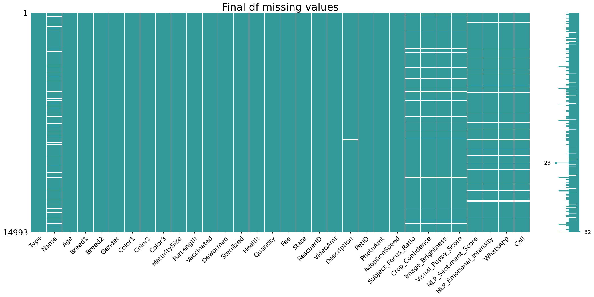
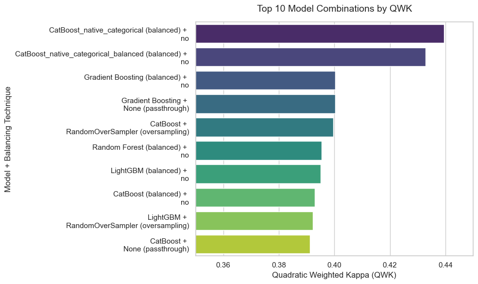
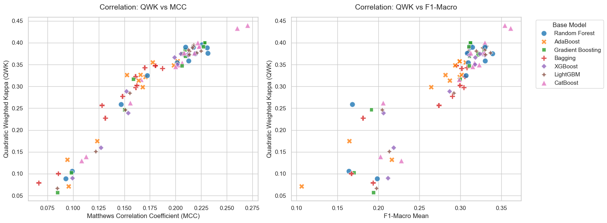
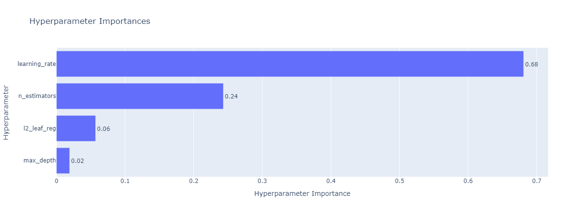
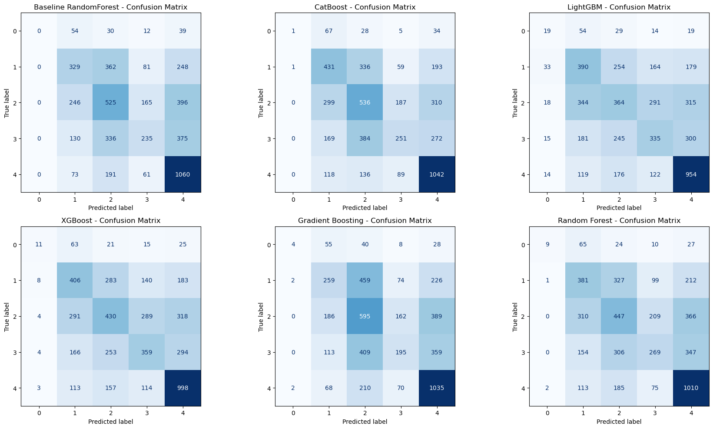
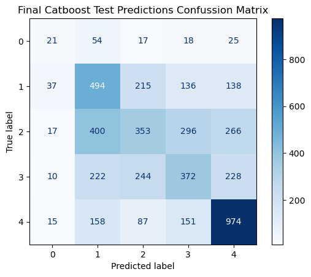

<div align="center">

# 🐾 Predicción de la Velocidad de Adopción (PetFinder.com)
### Pipeline de Aprendizaje Automático Avanzado: Ingeniería de Características Multimodal, Mitigación del Desbalanceo y Métodos de Ensamblado

[](#)
[](README.md)
[](#)
[](#)
[](#)
[](#)
[](#)
[](#)

---

**Leer esta documentación en:** [Español (Actual)](README.es.md) | [English (Inglés)](README.md)

</div>

---

## 📌 Resumen Ejecutivo y Descripción del Proyecto

Los refugios y protectoras de animales se enfrentan a problemas logísticos y de sobreocupación que impactan directamente en el bienestar animal. Mientras que ciertas mascotas encuentran hogar en cuestión de horas o días, otras permanecen meses esperando una familia adoptiva. Comprender qué factores influyen en el tiempo de adopción permite a las protectoras optimizar las fichas de los animales, gestionar mejor los recursos veterinarios y de acogida, y diseñar campañas de adopción proactivas.

Este proyecto aborda el reto propuesto en la competición **PetFinder.com Adoption Speed Prediction** (Kaggle). El objetivo consiste en desarrollar un sistema integral y reproducible de Machine Learning capaz de predecir la velocidad de adopción de una mascota (`AdoptionSpeed`, variable ordinal de 0 a 4) a partir de datos **multimodales**: **perfiles tabulares del animal**, **metadatos de visión por computador (Google Cloud Vision)** y **análisis de sentimiento y entidades en el texto (Google Cloud Natural Language)**.

### Logros Principales:
- **Ingeniería de Características Multimodal**: Extracción y agregación de métricas de calidad de imagen (brillo, encuadre/foco, detección de cachorros) y de texto (polaridad de sentimiento, intensidad emocional, canales de contacto directo como WhatsApp o llamada).
- **Impacto Multimodal Cuantificado**: La incorporación de variables de Vision y NLP elevó el rendimiento del modelo base de **0.3625 QWK** a **0.3882 QWK** (+0.0257 de mejora neta).
- **Prevención de Data Leakage**: Sustitución del Target Encoding clásico (que causaba sobreajuste extremo) por Leave-One-Out Encoding (LOOE) regularizado con ruido gaussiano ($\sigma$) encapsulado dentro de pipelines de validación cruzada.
- **Benchmark Exhaustivo de Desbalanceo**: Evaluación sistemática de **86 combinaciones** entre 7 familias de modelos y 11 técnicas de balanceo (sobremuestreo, submuestreo y ponderación algorítmica).
- **Optimización Bayesiana con Optuna**: Más de 500 pruebas registradas en bases de datos SQLite optimizando conjuntamente hiperparámetros de modelo y del preprocesador.
- **Rendimiento Máximo en Test**: Se alcanzó un **Quadratic Weighted Kappa (QWK) de 0.4412** y un **F1-Macro de 0.3845** en el conjunto de prueba independiente con **CatBoost Balanceado**, superando holgadamente tanto a modelos baseline (0.0000 QWK) como a modelos por defecto (0.3882 QWK).

---

## 🎯 Definición del Problema y Métrica de Evaluación

La variable objetivo es `AdoptionSpeed`, una **categoría ordinal** con 5 niveles:

| Clase | Plazo de Adopción | Descripción | Muestras Train | % Train | Muestras Test | % Test |
|:---:|:---|:---|:---:|:---:|:---:|:---:|
| **0** | Mismo Día | Adoptado el mismo día de su publicación | 274 | 2.73% | 136 | 2.75% |
| **1** | 1 - 7 Días | Adoptado en su primera semana | 2,070 | 20.61% | 1,020 | 20.61% |
| **2** | 8 - 30 Días | Adoptado en el primer mes | 2,708 | 26.96% | 1,333 | 26.94% |
| **3** | 31 - 90 Días | Adoptado entre el segundo y tercer mes | 2,183 | 21.73% | 1,076 | 21.75% |
| **4** | 100+ Días | No adoptado en el periodo de seguimiento | 2,810 | 27.97% | 1,383 | 27.95% |
| **Total** | | | **10,045** | **100%** | **4,948** | **100%** |

```
Distribución del Target (Fuerte Desbalanceo en Clase 0):
[0] █ 2.7%
[1] ██████████ 20.6%
[2] █████████████ 27.0%
[3] ███████████ 21.7%
[4] ██████████████ 28.0%
```

### Métrica Principal: Quadratic Weighted Kappa (QWK)
Dado el carácter ordinal de la variable, los errores entre clases lejanas (ej. predecir 4 cuando la realidad es 0) se penalizan de forma cuadrática en comparación con discrepancias adyacentes (ej. predecir 1 cuando la realidad es 0):

$$QWK = 1 - \frac{\sum_{i,j} w_{i,j} O_{i,j}}{\sum_{i,j} w_{i,j} E_{i,j}}, \quad \text{donde } w_{i,j} = \frac{(i - j)^2}{(N - 1)^2}$$

Métricas secundarias monitorizadas: **F1-Macro**, **Balanced Accuracy** y **Coeficiente de Correlación de Matthews (MCC)**.

---

## 🏗️ Arquitectura del Pipeline de Machine Learning

```mermaid
flowchart TD
    subgraph Ingestion["1. Ingesta Multimodal"]
        A1["Datos Tabulares (data.csv)\nEdad, Raza, Sexo, Tarifa, Estado, etc."]
        A2["JSONs Google Vision\nColores dominantes, Crop hints, Etiquetas"]
        A3["JSONs Google NLP\nSentimiento de documento, Entidades"]
    end

    subgraph FeatureEngineering["2. Preprocesamiento e Ingeniería de Características"]
        B1["ETL Visual: Brillo de imagen, Ratio de foco, Score cachorro"]
        B2["ETL Texto: Polaridad sentimiento, Intensidad, Flags WhatsApp/Llamada"]
        B3["Imputación de Nulos y Agregación por PetID"]
        B4["Codificación sin Leakage: LOOE (σ=ruido) vs Categóricas Nativas"]
    end

    subgraph ImbalanceStudy["3. Mitigación del Desbalanceo (86 Ensayos)"]
        C1["Remuestreo: SMOTE, ADASYN, ROS, RUS, Tomek, ENN"]
        C2["Sensible al Coste: class_weight='balanced'"]
        C3["Evaluación: QWK, F1-Macro, MCC, Balanced Accuracy"]
    end

    subgraph OptunaTuning["4. Optimización de Hiperparámetros (Optuna)"]
        D1["Tuning CatBoost (Categóricas Nativas)"]
        D2["Tuning LightGBM y XGBoost (+ ROS)"]
        D3["Tuning Random Forest y Gradient Boosting"]
        D4["Ajuste Conjunto del Ruido σ de LOOE"]
    end

    subgraph EnsemblesAndFinal["5. Ensamblados y Evaluación en Test"]
        E1["Soft Voting Classifier [1, 2, 5, 2, 1]"]
        E2["Stacking Classifier (Regresión Logística y Ridge Ordinal)"]
        E3["Test Set Independiente (33% = 4,948 muestras)"]
        E4["Modelo Ganador: CatBoost Balanceado (QWK: 0.4412)"]
    end

    Ingestion --> FeatureEngineering
    FeatureEngineering --> ImbalanceStudy
    ImbalanceStudy --> OptunaTuning
    OptunaTuning --> EnsemblesAndFinal
```



---

## 🔬 Desglose Metodológico por Fases

### Fase 1: Preprocesamiento Estructural e Ingeniería de Características (`preprocessing/`)
- **Extracción de Metadatos de Visión por Computador**:
  - `Image_Brightness`: Calculado mediante la fórmula perceptiva ITU-R BT.601 ponderada por el peso del color dominante:
    $$\text{Brillo} = \sum_{c} \left(0.299 R_c + 0.587 G_c + 0.114 B_c\right) \times \text{Score}_c$$
  - `Subject_Focus_Ratio`: Mide la proporción de encuadre del sujeto calculando el área del polígono envolvente de `cropHints` respecto a las dimensiones totales ($\text{Área}_{\text{crop}} / (\text{Ancho} \times \text{Alto})$).
  - `Crop_Confidence`: Grado de certidumbre del algoritmo de recorte automático.
  - `Visual_Puppy_Score`: Nivel de confianza cuando la API detecta explícitamente la etiqueta "puppy".
  - Agregación por mascota: Al existir múltiples imágenes por animal, se agrupan por `PetID` (medias de brillo y encuadre, máximo para el indicador de cachorro).
- **Extracción de Lenguaje Natural**:
  - `NLP_Sentiment_Score`: Polaridad del texto en el rango $[-1.0, 1.0]$.
  - `NLP_Emotional_Intensity`: Magnitud emocional acumulada en la descripción.
  - `WhatsApp` y `Call`: Banderas booleanas que indican presencia explícita de canales de contacto directo en las entidades extraídas.
  - `has_name`, `has_description`, `has_sentiment_data`, `Name_length`.
- **Tratamiento de Valores Faltantes**:
  - Imputación mediante valores centinela específicos ($-1$ o $-99$ para scores continuos, $0$ para variables binarias).

<div align="center">
  
  <p><em>Matriz de ausencia de datos tras la agregación y validación del conjunto multimodal.</em></p>
</div>

- **Estrategia de Codificación y Control de Fuga de Datos (Data Leakage)**:
  Se evaluaron cinco arquitecturas de codificación con un baseline de Random Forest:
  - `preprocessorClassic` (One-Hot + Target Encoder): Provocó un severo memorismo / leakage (Train F1: 1.000, Train QWK: 1.000 frente a Test QWK: 0.3919).
  - `preprocessorLOEEALL` (StandardScaler + Leave-One-Out Encoding con ruido gaussiano $\sigma=0.05$ en todas las variables categóricas): Mitigó drásticamente el sobreajuste (Train F1: 0.4709, Train QWK: 0.5879 frente a Test QWK: 0.3883).
  - Este preprocesador se integró en los pipelines de validación cruzada para asegurar que ningún dato del pliegue de validación se filtre durante el entrenamiento.

---

### Fase 2: Análisis y Mitigación del Desbalanceo (`imbalance_analysis_mitigation/`)
La clase 0 (adopción el mismo día) representa únicamente el 2.7% del conjunto. Se llevó a cabo un estudio exhaustivo con **86 combinaciones**:

- **7 Familias de Modelos**: Random Forest, AdaBoost, Gradient Boosting, Bagging, XGBoost, LightGBM, CatBoost.
- **11 Estrategias de Balanceo**:
  - *Sobremuestreo*: SMOTE, BorderlineSMOTE, ADASYN, RandomOverSampler (ROS).
  - *Submuestreo*: RandomUnderSampler (RUS), EditedNearestNeighbours (ENN), NearMiss, TomekLinks.
  - *Híbridas*: SMOTEENN, SMOTETomek.
  - *Algorítmicas*: Pesos de clase balanceados (`class_weight='balanced'`).

<div align="center">
  
  <p><em>Top 10 combinaciones de modelo y técnica ordenadas por QWK en validación cruzada de 5 folds.</em></p>
</div>

#### Conclusiones Clave del Estudio de Desbalanceo:
1. **El submuestreo deteriora el rendimiento**: Técnicas como NearMiss y RandomUnderSampler destruyen información valiosa de las clases mayoritarias, reduciendo el QWK general.
2. **El sobremuestreo sintético (SMOTE/ADASYN) genera ruido**: En espacios de alta dimensionalidad con variables codificadas, la interpolación crea ejemplos sintéticos en regiones ambiguas.
3. **`RandomOverSampler` y los pesos balanceados obtuvieron los mejores resultados**: Superaron a las técnicas complejas sin distorsionar la frontera de decisión.
4. **CatBoost con variables categóricas nativas lideró la comparativa**: Gracias a sus estadísticas de target ordenadas por permutación, alcanzó un **QWK de 0.4396** sin necesidad de remuestreo externo.

<div align="center">
  
  <p><em>Correlación entre QWK, MCC y Balanced Accuracy a lo largo de las 86 configuraciones.</em></p>
</div>

---

### Fase 3: Optimización de Hiperparámetros (`hyperparameter_tuning/`)
Mediante optimización bayesiana en **Optuna** con persistencia en SQLite y 5-fold Stratified Cross-Validation:

- **Optimización Conjunta Modelo-Preprocesador**: Se incluyó la dispersión de ruido de LOOE (`looe_sigma`) dentro del espacio de búsqueda para maximizar la generalización.
- **Modelos Optimizados**:
  - **CatBoost**: `learning_rate: 0.03`, `max_depth: 6`, `n_estimators: 1000`, `l2_leaf_reg: 3.0` $\rightarrow$ **CV QWK: 0.4434**
  - **LightGBM (+ ROS)**: `learning_rate: 0.0211`, `num_leaves: 49`, `max_depth: 14`, `min_child_samples: 8`, `colsample_bytree: 1.0`, `subsample: 0.7392`, `looe_sigma: 0.0173` $\rightarrow$ **CV QWK: 0.4234**
  - **XGBoost (+ ROS)**: `n_estimators: 552`, `max_depth: 10`, `learning_rate: 0.0129`, `subsample: 0.6459`, `colsample_bytree: 0.6170`, `min_child_weight: 1`, `looe_sigma: 0.0108` $\rightarrow$ **CV QWK: 0.4201**
  - **Gradient Boosting**: `n_estimators: 138`, `max_depth: 3`, `learning_rate: 0.0788`, `min_samples_leaf: 32`, `subsample: 0.9993`, `max_features: 0.7944`, `looe_sigma: 0.0214` $\rightarrow$ **CV QWK: 0.4175**
  - **Random Forest**: `n_estimators: 505`, `max_depth: 60`, `min_samples_split: 11`, `min_samples_leaf: 1`, `max_features: 'sqrt'`, `looe_sigma: 0.0133` $\rightarrow$ **CV QWK: 0.4173**

<div align="center">
  
  <p><em>Gráfico de importancia de parámetros en CatBoost generado a partir del estudio de Optuna.</em></p>
</div>

#### Modelos de Ensamblado:
- **Voting Classifier (Soft)**: Ponderación de probabilidades `[1, 2, 5, 2, 1]` asignada a `[RF, LGBM, CatBoost, XGBoost, GBM]`, otorgando mayor peso a CatBoost $\rightarrow$ **CV QWK: 0.4435**.
- **Stacking Classifier**: Metamodelo de Regresión Logística con ajuste de regularización C=0.1 (**CV QWK: 0.4484**) y Stacking Ordinal mediante regresor Ridge con redondeo discreto para respetar la escala ordinal.

---

### Fase 4: Evaluación Final y Comparativa en el Conjunto de Test (`main/`)

Todas las evaluaciones finales se realizaron sobre un conjunto de test independiente (**4,948 animales**) reservado desde el inicio con estratificación (33%).

#### 📊 Tabla Completa de Resultados en el Conjunto de Test

| Modelo | Variante / Mitigación | Test QWK 🏆 | Test F1-Macro | Train QWK | Train F1-Macro | Categoría |
|:---|:---|:---:|:---:|:---:|:---:|:---:|
| **Dummy (Más Frecuente)** | Predice siempre la clase mayoritaria (4) | `0.0000` | `0.0875` | `0.0000` | `0.0875` | Baseline Trivial |
| **Dummy (Estratificado)** | Predicción aleatoria proporcional a clases | `-0.0049` | `0.2018` | `-0.0052` | `0.1991` | Baseline Aleatorio |
| **Random Forest (Solo Tabular)** | CSV original sin variables de Vision/NLP | `0.3625` | `0.3051` | `0.5070` | `0.3864` | Baseline Sin Multimodal |
| **Random Forest (Multimodal)** | Hiperparámetros por defecto con todo el dataset | `0.3882` | `0.3254` | `0.6890` | `0.6101` | Baseline Multimodal |
| **Gradient Boosting** | Optimizado + LOOE con Ruido Gaussiano | `0.3937` | `0.3204` | `0.5481` | `0.4192` | Modelo Individual |
| **Stacking Classifier** | Metamodelo de Regresión Logística (C=0.1) | `0.3935` | `0.3546` | `0.7216` | `0.6062` | Ensamblado |
| **LightGBM** | Optimizado + RandomOverSampler | `0.3985` | `0.3551` | `0.6482` | `0.5941` | Modelo Individual |
| **Stacking (Ridge Ordinal)** | Regresión Ridge con Mapeo Discreto Ordinal | `0.3994` | `0.2328` | `0.6507` | `0.3507` | Ensamblado Ordinal |
| **Random Forest** | Optimizado + LOOE con Ruido Gaussiano | `0.4021` | `0.3499` | `0.6683` | `0.6446` | Modelo Individual |
| **XGBoost** | Optimizado + RandomOverSampler | `0.4131` | `0.3640` | `0.6790` | `0.6432` | Modelo Individual |
| **Voting Classifier** | Votación Suave Ponderada `[1, 2, 5, 2, 1]` | `0.4315` | `0.3775` | `0.7628` | `0.7396` | Ensamblado |
| **CatBoost (Nativo)** | Optimizado con Categóricas Nativas | `0.4387` | `0.3518` | `0.7636` | `0.5836` | Modelo Individual |
| **CatBoost Balanceado** | **Optimizado + Pesos de Clase Balanceados** | **`0.4412`** | **`0.3845`** | **`0.7971`** | **`0.7532`** | **👑 Modelo Ganador** |

<div align="center">
  
  <p><em>Comparativa de matrices de confusión sobre el conjunto de test independiente (4,948 muestras).</em></p>
</div>

<div align="center">
  
  <p><em>Matriz de confusión del Modelo Ganador (CatBoost Balanceado). La masa de errores se concentra estrictamente en clases vecinas, maximizando el QWK.</em></p>
</div>

---

## 💡 Conclusiones Principales

1. **Aporte Cuantificable de la Información Multimodal**: Añadir métricas de imagen (foco, brillo, cachorro) y de texto (polaridad, WhatsApp, llamadas) mejoró el rendimiento base en **+0.0257 QWK**. La calidad fotográfica y la facilidad de contacto son factores determinantes en la adopción real.
2. **El Control de Data Leakage es Crítico**: Variables de alta cardinalidad (`RescuerID`, `Breed1`, `State`) sobreajustan de inmediato si se usa un Target Encoding ingenuo. La regularización con Leave-One-Out Encoding y ruido gaussiano garantiza métricas de validación fiables.
3. **CatBoost es la Mejor Opción para Datos Tabulares y Categóricos**: El algoritmo de CatBoost superó de forma sistemática al resto de arquitecturas de árboles potenciados gracias a su manejo nativo de variables cualitativas.
4. **Impacto Práctico del Balanceo de Clases**: Incorporar pesos balanceados en CatBoost permitió detectar correctamente adopciones inmediatas (Clase 0), elevando el F1-Macro de **0.3518** a **0.3845** y alcanzando el récord de **0.4412 en QWK**.

---

## 📁 Estructura del Repositorio

```plaintext
pet-finder/
│
├── README.md                                 # Documentación en inglés
├── README.es.md                              # Documentación en español (este archivo)
│
├── preprocessing/                            # Parte 1: ETL e ingeniería de características
│   ├── initial_analysis/
│   │   └── initial_analysis.py               # Análisis exploratorio del target
│   ├── intermediate_data/                    # Archivos parquet generados durante el ETL
│   │   ├── cleaned_parquets/                 # Dataframes limpios de metadatos y sentimiento
│   │   ├── raw_final_df/                     # Dataframe multimodal unificado
│   │   └── raw_parquets/                     # Parquets en bruto extraídos de los JSON
│   ├── preprocessor.py                       # ColumnTransformers sin leakage para Scikit-Learn
│   └── preprocessing.ipynb                   # Cuaderno de ETL, Visión y NLP paso a paso
│
├── imbalance_analysis_mitigation/            # Parte 2: Estudio y benchmark de desbalanceo
│   ├── technique_results/
│   │   ├── final_results.csv                 # 86 resultados experimentales (QWK, F1, MCC, Acc)
│   │   └── partial_results.csv               # Ejecuciones intermedias
│   └── imbalance_analysis_mitigation.ipynb   # Ejecución del benchmark de 86 combinaciones
│
├── hyperparameter_tuning/                    # Parte 3: Optimización bayesiana con Optuna
│   ├── optuna_studies/                       # Bases de datos SQLite persistentes (.db)
│   │   ├── cat_study.db                      # Estudio para CatBoost
│   │   ├── gbm_study.db                      # Estudio para Gradient Boosting
│   │   ├── lgbm_study.db                     # Estudio para LightGBM
│   │   ├── rf_study.db                       # Estudio para Random Forest
│   │   └── xgb_study.db                      # Estudio para XGBoost
│   ├── optimized_results.csv                 # Métricas de validación de modelos optimizados
│   └── hyperparameter_tuning.ipynb           # Pruebas Optuna, ensamblados y gráficos de importancia
│
├── main/                                     # Parte 4: Entrenamiento final y evaluación en test
│   └── main.ipynb                            # Comparativa con baselines, métricas en test y matrices
│
├── images/                                   # Gráficos y visualizaciones generadas
│   ├── 1_part/                               # Visualizaciones de valores nulos
│   ├── 2_part/                               # Distribuciones de desbalanceo y Top 10
│   ├── 3_part/                               # Gráficos de importancia de hiperparámetros
│   └── 4_part/                               # Matrices de confusión en test
│
└── data/                                     # Conjuntos de datos (excluidos de Git según tamaño)
    ├── breed_labels.csv
    ├── color_labels.csv
    ├── state_labels.csv
    ├── data.csv
    └── cleaned/                              # Particiones X_train, X_test, y_train, y_test
```

---

## 🚀 Guía de Instalación y Ejecución

### 1. Requisitos Previos y Entorno Virtual
Se recomienda utilizar **Python 3.11** o **3.12**. Clona el repositorio y crea un entorno virtual:

```bash
git clone https://github.com/tu-usuario/pet-finder.git
cd pet-finder

# Crear y activar entorno virtual
python -m venv .venv

# En Windows (PowerShell):
.venv\Scripts\Activate.ps1

# En Linux / macOS:
source .venv/bin/activate
```

### 2. Instalación de Dependencias
```bash
pip install numpy pandas scikit-learn imbalanced-learn category_encoders \
            lightgbm xgboost catboost optuna matplotlib seaborn missingno \
            jmespath pillow pyarrow
```

### 3. Orden de Ejecución Recomendado
Para reproducir la totalidad de los experimentos:
1. `preprocessing/preprocessing.ipynb`: Extrae los atributos de los archivos JSON de Vision y NLP, realiza la imputación de nulos y genera `cleaned_df_final.parquet`.
2. `imbalance_analysis_mitigation/imbalance_analysis_mitigation.ipynb`: Ejecuta el benchmark de 86 combinaciones de modelos y técnicas de muestreo.
3. `hyperparameter_tuning/hyperparameter_tuning.ipynb`: Carga los estudios SQLite o lanza nuevas iteraciones de Optuna para hallar los mejores hiperparámetros.
4. `main/main.ipynb`: Entrena los modelos optimizados con `X_train`, evalúa sobre el conjunto de prueba `X_test` y genera las matrices de confusión finales.

---

<div align="center">
  <sub>Entregable de Machine Learning Avanzado · Predicción de la Velocidad de Adopción de PetFinder</sub>
  <br>
  <sub>Documentación disponible en <b><a href="README.md">English</a></b> y <b><a href="README.es.md">Español</a></b></sub>
</div>

