<div align="center">

# 🐾 Pet Adoption Speed Prediction (PetFinder.com)
### Advanced Machine Learning Pipeline: Multimodal Feature Engineering, Imbalance Mitigation & Ensembling

[](#)
[](README.es.md)
[](#)
[](#)
[](#)
[](#)
[](#)
[](#)

---

**Read this documentation in:** [English (Current)](README.md) | [Español (Spanish)](README.es.md)

</div>

---

## 📌 Executive Summary & Project Overview

Animal shelters worldwide face operational bottlenecks that directly impact animal welfare. In many shelters, pets wait weeks or months before finding an adoptive family, while others are adopted immediately. Understanding the key drivers influencing adoption speed allows shelters and rescue organizations to improve animal profiles, allocate medical and foster care resources, and design proactive adoption campaigns.

This project addresses the **PetFinder.com Adoption Speed Prediction** challenge, originally hosted on Kaggle. The goal is to develop an end-to-end, leak-free machine learning system capable of predicting how fast an animal will be adopted (`AdoptionSpeed`, an ordinal metric from 0 to 4) using a rich multimodal dataset combining **tabular animal profiles**, **Google Cloud Vision computer vision metadata**, and **Google Cloud Natural Language sentiment analysis**.

### Key Achievements:
- **Multimodal Feature Extraction**: Engineered visual focus, composition, brightness, puppy detection, and sentiment polarity/emotional intensity features from raw JSON files.
- **Multimodal Lift**: Proved that adding Vision and NLP features improved the baseline model from **0.3625 QWK** to **0.3882 QWK** (+0.0257 absolute lift).
- **Leak-Free Encodings**: Solved massive target leakage with Leave-One-Out Encoding (LOOE) regularized with Gaussian noise ($\sigma$).
- **Imbalance Benchmark**: Evaluated **86 distinct combinations** of 7 model families across 11 imbalance mitigation strategies (oversampling, undersampling, and algorithmic class weighting).
- **Bayesian Optimization**: Tuned models and preprocessing hyper-parameters with **Optuna**, evaluating over 500 trials tracked via SQLite.
- **Top Performance**: Reached a test set **Quadratic Weighted Kappa (QWK) of 0.4412** and **Macro F1 of 0.3845** with **Balanced CatBoost**, outperforming naive baselines (0.0000 QWK) and default models (0.3882 QWK).

---

## 🎯 Problem Formulation & Evaluation Metric

The target variable is `AdoptionSpeed`, an **ordinal categorical variable** with 5 classes:

| Class | Adoption Horizon | Description | Train Count | Train % | Test Count | Test % |
|:---:|:---|:---|:---:|:---:|:---:|:---:|
| **0** | Same Day | Adopted the day of listing | 274 | 2.73% | 136 | 2.75% |
| **1** | 1 - 7 Days | Adopted within 1st week | 2,070 | 20.61% | 1,020 | 20.61% |
| **2** | 8 - 30 Days | Adopted within 1st month | 2,708 | 26.96% | 1,333 | 26.94% |
| **3** | 31 - 90 Days | Adopted within 2nd - 3rd month | 2,183 | 21.73% | 1,076 | 21.75% |
| **4** | 100+ Days | Not adopted within tracking period | 2,810 | 27.97% | 1,383 | 27.95% |
| **Total** | | | **10,045** | **100%** | **4,948** | **100%** |

```
Target Distribution (Severe Minority at Class 0):
[0] █ 2.7%
[1] ██████████ 20.6%
[2] █████████████ 27.0%
[3] ███████████ 21.7%
[4] ██████████████ 28.0%
```

### Primary Evaluation Metric: Quadratic Weighted Kappa (QWK)
Because adoption speed is an ordinal scale, errors between distant classes (e.g., predicting 4 when the true value is 0) are significantly worse than errors between adjacent classes (e.g., predicting 1 when the true value is 0). 

$$QWK = 1 - \frac{\sum_{i,j} w_{i,j} O_{i,j}}{\sum_{i,j} w_{i,j} E_{i,j}}, \quad \text{where } w_{i,j} = \frac{(i - j)^2}{(N - 1)^2}$$

Secondary metrics monitored: **Macro F1-Score**, **Balanced Accuracy**, and **Matthews Correlation Coefficient (MCC)**.

---

## 🏗️ End-to-End Pipeline Architecture

```mermaid
flowchart TD
    subgraph DataSources["1. Multimodal Ingestion"]
        A1["Tabular Data (data.csv)\nAge, Breed, Gender, Fee, State, etc."]
        A2["Google Vision JSONs\nDominant colors, Crop hints, Labels"]
        A3["Google NLP JSONs\nDocument sentiment, Entities"]
    end

    subgraph FeatureEngineering["2. Preprocessing & Feature Engineering"]
        B1["ETL: Image Brightness, Focus Ratio, Puppy Score"]
        B2["ETL: Sentiment Polarity, Magnitude, WhatsApp/Call Flags"]
        B3["Missing Value Imputation & Metadata Aggregation"]
        B4["Leak-Free Encoding: LOOE (σ=noise) vs Native Categoricals"]
    end

    subgraph ImbalanceStudy["3. Imbalance Mitigation (86 Combinations)"]
        C1["Resampling: SMOTE, ADASYN, ROS, RUS, Tomek, ENN"]
        C2["Cost-Sensitive: class_weight='balanced'"]
        C3["Benchmarking: QWK, Macro F1, MCC, Balanced Accuracy"]
    end

    subgraph OptunaTuning["4. Hyperparameter Tuning (Optuna)"]
        D1["CatBoost Tuning (Native Categoricals)"]
        D2["LightGBM & XGBoost Tuning (+ ROS)"]
        D3["Random Forest & Gradient Boosting Tuning"]
        D4["Joint tuning with Preprocessor LOOE σ"]
    end

    subgraph EnsemblesAndFinal["5. Ensembling & Test Set Validation"]
        E1["Soft Voting Classifier [1, 2, 5, 2, 1]"]
        E2["Stacking Classifier (Logistic Regression & Ordinal Ridge)"]
        E3["Independent Test Set (33% = 4,948 samples)"]
        E4["Final Selection: Balanced CatBoost (QWK: 0.4412)"]
    end

    DataSources --> FeatureEngineering
    FeatureEngineering --> ImbalanceStudy
    ImbalanceStudy --> OptunaTuning
    OptunaTuning --> EnsemblesAndFinal
```



---

## 🔬 Detailed Implementation Breakdown

### Part 1: Structural Preprocessing & Feature Engineering (`preprocessing/`)
- **Metadata Computer Vision Features**:
  - `Image_Brightness`: Computed using perceptual ITU-R BT.601 luminous formula:
    $$\text{Brightness} = \sum_{c} \left(0.299 R_c + 0.587 G_c + 0.114 B_c\right) \times \text{Score}_c$$
  - `Subject_Focus_Ratio`: Evaluated framing quality using crop hints bounding polygon area over total image resolution ($\text{Area}_{\text{crop}} / (\text{Width} \times \text{Height})$).
  - `Crop_Confidence`: Google Cloud Vision crop algorithm confidence.
  - `Visual_Puppy_Score`: Extracted confidence score when the label annotation "puppy" is recognized.
  - Aggregation: For pets with multiple photos, metrics are aggregated by `PetID` (mean for brightness and focus, max for puppy score).
- **Natural Language & Text Features**:
  - `NLP_Sentiment_Score`: Text polarity score in range $[-1.0, 1.0]$.
  - `NLP_Emotional_Intensity`: Magnitude of sentiment.
  - `WhatsApp` & `Call`: Binary indicators capturing explicit contact cues in description entities.
  - `has_name`, `has_description`, `has_sentiment_data`, `Name_length`.
- **Handling Missing Values & Imputation**:
  - Missing visual and sentiment features imputed with domain-safe sentinel values ($-1$ or $-99$ for scores, $0$ for contact flags).

<div align="center">
  
  <p><em>Missing values matrix after aggregation and validation across all tabular, vision, and NLP attributes.</em></p>
</div>

- **Encoding Strategy & Preventing Data Leakage**:
  We compared five encoding setups using an initial Random Forest baseline:
  - `preprocessorClassic` (StandardScaler + OneHot + TargetEncoder): Produced massive target leakage (Train F1: 1.000, Train QWK: 1.000 vs Test QWK: 0.3919).
  - `preprocessorLOEEALL` (StandardScaler + Leave-One-Out Encoding with $\sigma=0.05$ Gaussian noise for all categoricals): Solved leakage and over-memorization (Train F1: 0.4709, Train QWK: 0.5879 vs Test QWK: 0.3883).
  - `preprocessorLOEEALL` was integrated directly inside Scikit-Learn / Imbalanced-Learn pipelines to ensure test folds remain completely untouched.

---

### Part 2: Imbalance Analysis & Mitigation (`imbalance_analysis_mitigation/`)
With class 0 representing less than 3% of the samples, default loss functions tend to ignore the minority class. We systematically benchmarked **86 combinations**:

- **7 Model Families**: Random Forest, AdaBoost, Gradient Boosting, Bagging, XGBoost, LightGBM, CatBoost.
- **11 Balancing Approaches**:
  - *Oversampling*: SMOTE, BorderlineSMOTE, ADASYN, RandomOverSampler (ROS).
  - *Undersampling*: RandomUnderSampler (RUS), EditedNearestNeighbours (ENN), NearMiss, TomekLinks.
  - *Hybrid*: SMOTEENN, SMOTETomek.
  - *Algorithmic*: `class_weight='balanced'` / `auto_class_weights='Balanced'`.

<div align="center">
  
  <p><em>Top 10 model + balancing combinations ranked by 5-fold cross-validated QWK.</em></p>
</div>

#### Key Insights from the Imbalance Study:
1. **Undersampling harms performance**: Techniques like NearMiss and RandomUnderSampler discard crucial training samples, resulting in sharp drops in QWK across all models.
2. **Synthetic oversampling (SMOTE/ADASYN) shows mixed results**: Generating interpolated points in high-dimensional feature spaces introduced noise in boundary regions.
3. **RandomOverSampler and Algorithmic Weighting won**: `RandomOverSampler` and internal loss weighting (`class_weight='balanced'`) consistently occupied the top ranks.
4. **CatBoost with Native Categoricals dominated**: Out-of-the-box CatBoost utilizing its proprietary ordered target statistics achieved **0.4396 QWK**, outperforming all other non-tuned algorithms.

<div align="center">
  
  <p><em>Correlation between QWK, MCC, and Balanced Accuracy across all 86 tested configurations.</em></p>
</div>

---

### Part 3: Hyperparameter Optimization (`hyperparameter_tuning/`)
Using **Optuna** backed by SQLite databases, we executed Bayesian optimization over hundreds of trials with 5-fold Stratified Cross-Validation:

- **Joint Optimization**: Along with tree and booster parameters, we included the Leave-One-Out smoothing noise `looe_sigma` inside the search space to maximize regularized encoding performance.
- **Models Tuned**:
  - **CatBoost**: `learning_rate: 0.03`, `max_depth: 6`, `n_estimators: 1000`, `l2_leaf_reg: 3.0` $\rightarrow$ **CV QWK: 0.4434**
  - **LightGBM (+ ROS)**: `learning_rate: 0.0211`, `num_leaves: 49`, `max_depth: 14`, `min_child_samples: 8`, `colsample_bytree: 1.0`, `subsample: 0.7392`, `looe_sigma: 0.0173` $\rightarrow$ **CV QWK: 0.4234**
  - **XGBoost (+ ROS)**: `n_estimators: 552`, `max_depth: 10`, `learning_rate: 0.0129`, `subsample: 0.6459`, `colsample_bytree: 0.6170`, `min_child_weight: 1`, `looe_sigma: 0.0108` $\rightarrow$ **CV QWK: 0.4201**
  - **Gradient Boosting**: `n_estimators: 138`, `max_depth: 3`, `learning_rate: 0.0788`, `min_samples_leaf: 32`, `subsample: 0.9993`, `max_features: 0.7944`, `looe_sigma: 0.0214` $\rightarrow$ **CV QWK: 0.4175**
  - **Random Forest**: `n_estimators: 505`, `max_depth: 60`, `min_samples_split: 11`, `min_samples_leaf: 1`, `max_features: 'sqrt'`, `looe_sigma: 0.0133` $\rightarrow$ **CV QWK: 0.4173**

<div align="center">
  
  <p><em>Optuna hyperparameter importance analysis for CatBoost.</em></p>
</div>

#### Ensembling:
- **Soft Voting Classifier**: Weighted soft probabilities using weights `[1, 2, 5, 2, 1]` for `[RF, LGBM, CatBoost, XGBoost, GBM]`, capitalizing on CatBoost's superiority $\rightarrow$ **CV QWK: 0.4435**.
- **Stacking Classifier**: Evaluated with Logistic Regression (C=0.1) as meta-learner (**CV QWK: 0.4484**) and a custom Ordinal Ridge Regressor wrapper to preserve class distance relationships.

---

### Part 4: Final Evaluation & Baseline Comparison (`main/`)

We reserved a strict 33% stratified test set (**4,948 unseen pets**) never touched during preprocessing, imbalance exploration, or Optuna tuning.

#### 📊 Comprehensive Test Set Results Table

| Model | Variant / Mitigation | Test QWK 🏆 | Test Macro F1 | Train QWK | Train Macro F1 | Status |
|:---|:---|:---:|:---:|:---:|:---:|:---:|
| **Dummy (Most Frequent)** | Baseline predicting majority class 4 | `0.0000` | `0.0875` | `0.0000` | `0.0875` | Trivial Baseline |
| **Dummy (Stratified)** | Baseline with random class proportions | `-0.0049` | `0.2018` | `-0.0052` | `0.1991` | Random Baseline |
| **Random Forest (Tabular Only)** | Original CSV without Vision/NLP features | `0.3625` | `0.3051` | `0.5070` | `0.3864` | Raw Features Baseline |
| **Random Forest (Multimodal)** | Default parameters on full feature set | `0.3882` | `0.3254` | `0.6890` | `0.6101` | Multimodal Baseline |
| **Gradient Boosting** | Tuned + LOOE Gaussian Noise | `0.3937` | `0.3204` | `0.5481` | `0.4192` | Optimized Single |
| **Stacking Classifier** | Logistic Regression Meta-Learner | `0.3935` | `0.3546` | `0.7216` | `0.6062` | Ensemble |
| **LightGBM** | Tuned + RandomOverSampler | `0.3985` | `0.3551` | `0.6482` | `0.5941` | Optimized Single |
| **Stacking (Ordinal Ridge)** | Ridge Meta-Learner with Class Rounding | `0.3994` | `0.2328` | `0.6507` | `0.3507` | Ordinal Ensemble |
| **Random Forest** | Tuned + LOOE Gaussian Noise | `0.4021` | `0.3499` | `0.6683` | `0.6446` | Optimized Single |
| **XGBoost** | Tuned + RandomOverSampler | `0.4131` | `0.3640` | `0.6790` | `0.6432` | Optimized Single |
| **Voting Classifier** | Soft Voting `[1, 2, 5, 2, 1]` | `0.4315` | `0.3775` | `0.7628` | `0.7396` | Ensemble |
| **CatBoost (Native)** | Tuned Native Categoricals | `0.4387` | `0.3518` | `0.7636` | `0.5836` | Optimized Single |
| **Balanced CatBoost** | **Tuned + Balanced Class Weights** | **`0.4412`** | **`0.3845`** | **`0.7971`** | **`0.7532`** | **👑 Champion Model** |

<div align="center">
  
  <p><em>Confusion matrix comparison across all final models on the 4,948-sample test set.</em></p>
</div>

<div align="center">
  
  <p><em>Final confusion matrix for the Champion Model (Balanced CatBoost). Errors are tightly centered around adjacent adoption horizons.</em></p>
</div>

---

## 💡 Key Takeaways & Conclusions

1. **Multimodal Value Proven**: Integrating Google Cloud Vision and Natural Language attributes yielded an immediate improvement of **+0.0257 QWK** over the tabular baseline. Profile quality, emotional warmth, and photo framing significantly affect adoption dynamics.
2. **Leakage Prevention is Essential**: High-cardinality features like `Breed1`, `Breed2`, and `RescuerID` cause massive over-memorization with standard Target Encoding. Regularized Leave-One-Out Encoding with noise smoothing proved critical for generalization.
3. **CatBoost is the Optimal Algorithm for Tabular-Categorical Data**: CatBoost's native handling of categorical features using target statistics computed on random permutations completely outperformed one-hot and manual LOOE encoders.
4. **Handling Imbalance Increases Real-World Adoption Utility**: Incorporating balanced class weights in CatBoost dramatically increased detection of same-day adoptions (Class 0) and improved the overall Macro F1-score from **0.3518** to **0.3845** while achieving the top QWK of **0.4412**.

---

## 📁 Repository Directory Structure

```plaintext
pet-finder/
│
├── README.md                                 # English documentation (this file)
├── README.es.md                              # Spanish documentation
│
├── preprocessing/                            # Part 1: Feature engineering & ETL
│   ├── initial_analysis/
│   │   └── initial_analysis.py               # Exploratory target analysis
│   ├── intermediate_data/                    # Parquet files from intermediate ETL steps
│   │   ├── cleaned_parquets/                 # Validated metadata and sentiment dataframes
│   │   ├── raw_final_df/                     # Merged multimodal dataframe
│   │   └── raw_parquets/                     # Extracted raw JSON parquets
│   ├── preprocessor.py                       # Leak-free Scikit-Learn ColumnTransformers
│   └── preprocessing.ipynb                   # Step-by-step ETL, Vision & NLP extraction
│
├── imbalance_analysis_mitigation/            # Part 2: Imbalance study & benchmarking
│   ├── technique_results/
│   │   ├── final_results.csv                 # 86 experimental results (QWK, F1, MCC, Acc)
│   │   └── partial_results.csv               # Intermediate runs
│   └── imbalance_analysis_mitigation.ipynb   # 86-combination benchmark execution
│
├── hyperparameter_tuning/                    # Part 3: Optuna Bayesian optimization
│   ├── optuna_studies/                       # Persistent SQLite databases (.db)
│   │   ├── cat_study.db                      # CatBoost study database
│   │   ├── gbm_study.db                      # Gradient Boosting study database
│   │   ├── lgbm_study.db                     # LightGBM study database
│   │   ├── rf_study.db                       # Random Forest study database
│   │   └── xgb_study.db                      # XGBoost study database
│   ├── optimized_results.csv                 # CV metrics of tuned individual models
│   └── hyperparameter_tuning.ipynb           # Optuna trials, ensembles & parameter charts
│
├── main/                                     # Part 4: Final training & test set validation
│   └── main.ipynb                            # Baseline comparisons, test scoring, confusion matrices
│
├── images/                                   # Visual assets generated during experiments
│   ├── 1_part/                               # Missing value visualizations
│   ├── 2_part/                               # Imbalance distributions & Top 10 bar charts
│   ├── 3_part/                               # Optuna parameter importance plots
│   └── 4_part/                               # Test set confusion matrices
│
└── data/                                     # Raw datasets (excluded from Git where applicable)
    ├── breed_labels.csv
    ├── color_labels.csv
    ├── state_labels.csv
    ├── data.csv
    └── cleaned/                              # Preprocessed X_train, X_test, y_train, y_test
```

---

## 🚀 Getting Started & Execution Guide

### 1. Prerequisites & Virtual Environment
Ensure you have **Python 3.11** or **3.12** installed. Clone this repository and configure the virtual environment:

```bash
git clone https://github.com/your-username/pet-finder.git
cd pet-finder

# Create and activate virtual environment
python -m venv .venv

# Windows PowerShell:
.venv\Scripts\Activate.ps1

# Linux / macOS:
source .venv/bin/activate
```

### 2. Install Required Dependencies
```bash
pip install numpy pandas scikit-learn imbalanced-learn category_encoders \
            lightgbm xgboost catboost optuna matplotlib seaborn missingno \
            jmespath pillow pyarrow
```

### 3. Execution Sequence
For reproducibility, execute notebooks in the following order:
1. `preprocessing/preprocessing.ipynb`: Extracts features from Google Cloud Vision and Natural Language JSON files, imputes missing values, and saves `cleaned_df_final.parquet`.
2. `imbalance_analysis_mitigation/imbalance_analysis_mitigation.ipynb`: Runs the benchmark comparing 86 model and resampling combinations.
3. `hyperparameter_tuning/hyperparameter_tuning.ipynb`: Loads SQLite studies or runs new Optuna trials to identify optimal hyperparameters.
4. `main/main.ipynb`: Trains baseline and optimized models on `X_train`, predicts on `X_test`, and generates final test metrics and confusion matrices.

---

<div align="center">
  <sub>PetFinder Adoption Speed Prediction</sub>
  <br>
  <sub>Documentation available in <b><a href="README.md">English</a></b> and <b><a href="README.es.md">Español</a></b></sub>
</div>
